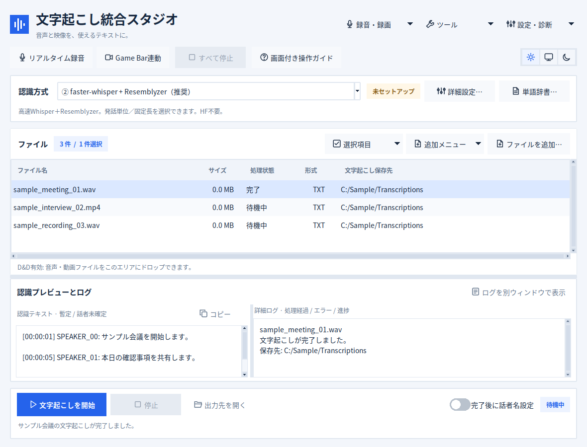
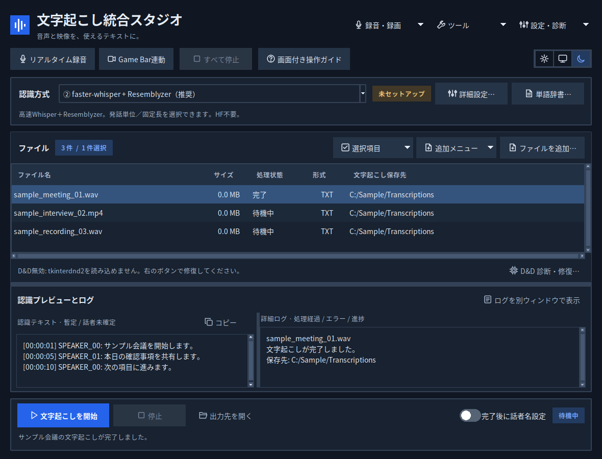
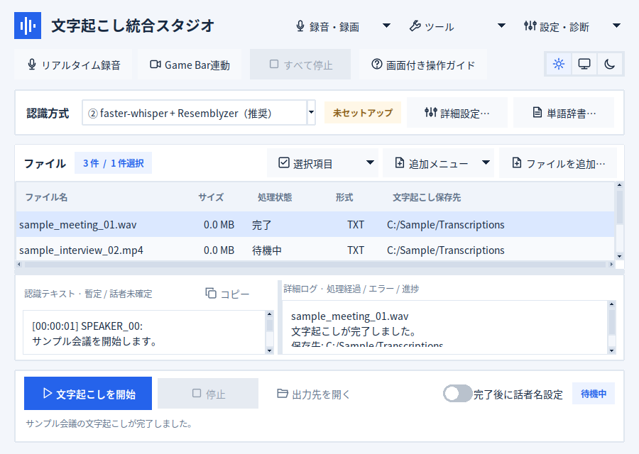
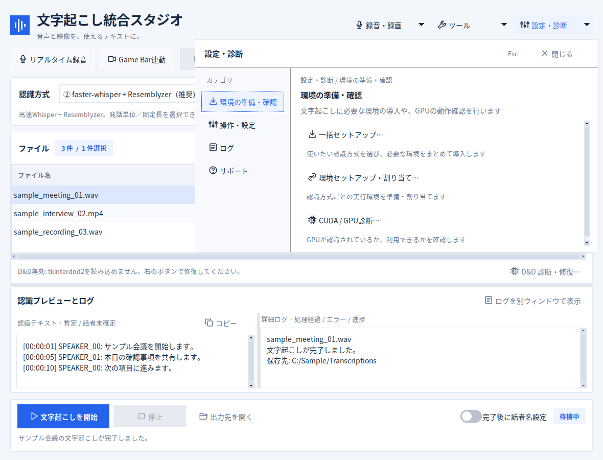
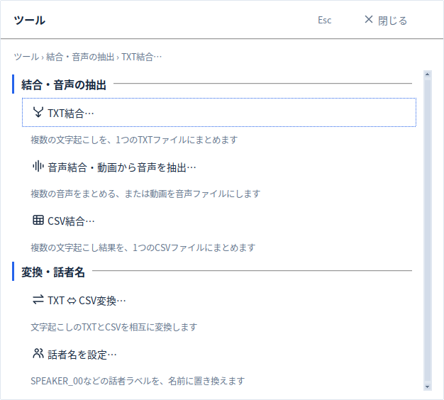
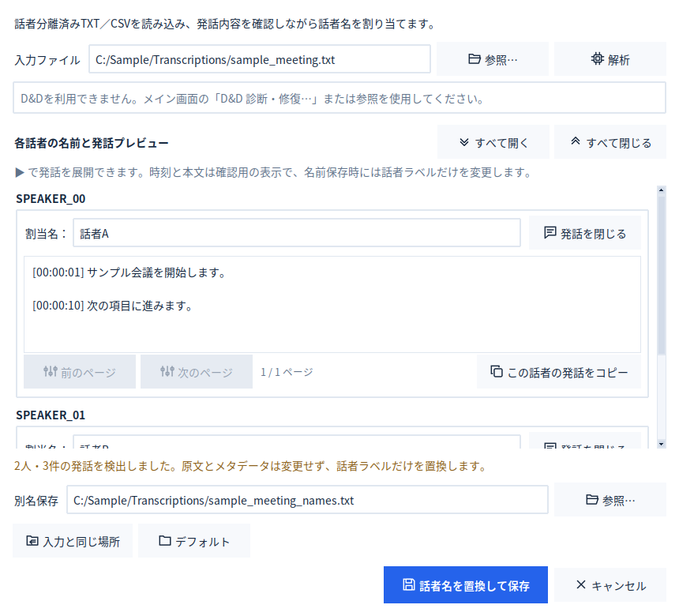
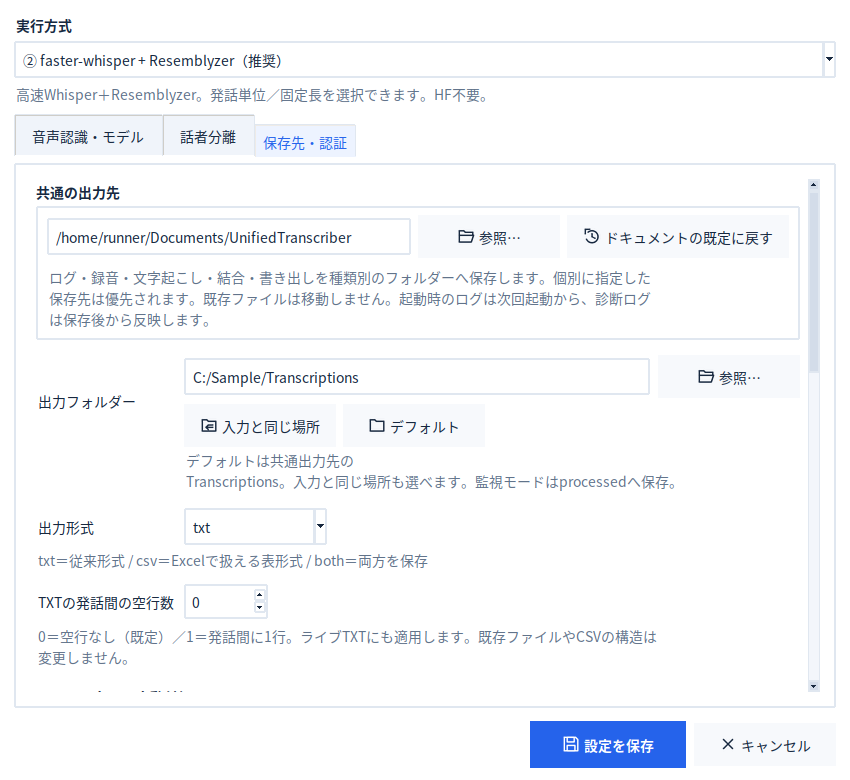
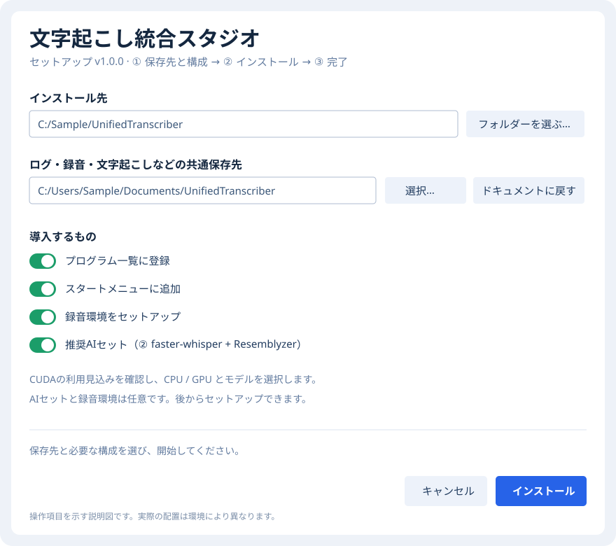

# 文字起こし統合スタジオ v1.0.3（Windows）

音声・動画の文字起こし、マイク・PC音の録音、Game Bar連携、話者名編集、結合・変換をまとめたWindows向けアプリです。録音から仕上げまで、1つの画面から進められます。

v1.0.3では、Hugging Faceのモデル取得、Windowsのキャッシュ動作、pyannote環境構築を修正し、文字起こし中の異常終了から復旧できる途中結果保存を追加しました。v1.0.2までのメニュー・出力設定の改善も含みます。

> **未署名のWindows版 v1.0.3** — 配布するexeにはAuthenticodeの発行元署名がありません。ブラウザー・SmartScreenで警告が出たり、Smart App Controlで実行を拒否されたりする場合があります。Windowsのセキュリティ機能を無効にすることは推奨しません。
>

**[セットアップexeをダウンロード](https://github.com/Ptcr8-tool/Unified_Transcriber_Windows/releases/latest)** · [画面付きの操作ガイド](_internal/docs/USAGE.md) · [リリース情報](_internal/docs/CHANGELOG.md)

公開リリースにある `Unified_Transcriber_Setup_v1.0.3.exe` と `SHA256SUMS.txt` を確認してください。GitHubのビルド出所証明も同梱しています。

## 画面プレビュー（v1.0.3）



**左から順に操作する必要はありません。** ファイルを追加して文字起こしするほか、上部の「リアルタイム録音」「Game Bar連動」から録音・録画にも進めます。「画面付き操作ガイド」からオフラインの解説を開けます。

<details>
<summary>ダークモード・コンパクト画面を表示</summary>

| ダーク表示 | 小さいウィンドウ |
| --- | --- |
|  |  |

</details>

<details>
<summary>再設計した「設定・診断」「ツール」のメニューを表示</summary>





「録音・録画」「ツール」は見出しの下から直接操作を選べます。「設定・診断」は左の分類から探せます。Escで閉じられ、表示中もメイン画面の位置は変わりません。

</details>

<details>
<summary>話者名編集・出力設定画面を表示</summary>

| 話者名を設定 | 保存先・認証などの詳細設定 |
| --- | --- |
|  |  |

話者編集の結果は元のTXT／CSVを上書きせず、**元ファイルと同じフォルダーに別名保存**します。

</details>

画面例は **v1.0.3の実際のTkウィジェットを架空のファイル名・文章で撮影**したものです。仮想画面で生成しているため、Windowsでのフォントや外観は多少異なる場合があります。実在する録音や個人情報は使用していません。

## はじめる — 最初のダウンロードはexeひとつ

1. リリースページから対応するセットアップexeを保存して開きます。PythonやAIライブラリが未導入のPCでも、同梱ランタイムで本体を起動できます。
2. **インストール先**と、ログ・録音・文字起こしなどの**共通保存先**を選びます。共通保存先の既定は **ドキュメント内の `UnifiedTranscriber`** です。プログラム一覧・スタートメニューへの登録や録音環境の導入も選べます。
3. すぐ文字起こしを使う場合は、**推奨AIセット（② faster-whisper + Resemblyzer）**を選びます。CUDAの事前確認結果を読み、CPU／対応NVIDIA GPUとモデルを選びます。モデルの既定は `large-v3-turbo` で、後から変更・追加できます。
4. 完了後の自動起動を選択するか、導入後に **`UnifiedTranscriber.exe`** またはショートカットから起動します。新規設定の認識方式は**②（推奨）**です。最初は数十秒の音声で、録音・保存先・認識結果を確認してください。

録音環境やAIモデルは、選択した場合にインターネットから追加取得します。モデル・PyTorchには数GB以上の空き容量が必要になる場合があります。追加取得が失敗してもアプリは残り、接続や空き容量を確認してアプリ内から再試行できます。

CUDAの事前表示は、NVIDIA GPU・ドライバー情報から見た利用の見込みです。実際の利用可否は環境導入後のCUDA診断で確認します。既存の設定を引き継ぐ場合は、選択済みの認識方式や個別の保存先を保持します。

**旧版からの更新**は、新しいセットアップexeで既存のインストール先を選んで進めます。v1.0.0、v1.0.0-a、v1.0.0-b、検証用v1.0.1、正式版v1.0.2、検証版v1.0.2-aからv1.0.3へ更新できます。[更新時の手順](_internal/docs/USAGE.md#旧版から更新する)

<details>
<summary>セットアップ画面を見る</summary>



</details>

## メイン画面の見方

最新のメイン画面は[画面プレビュー](#画面プレビューv103)をご覧ください。

| 場所 | 主な操作 |
| --- | --- |
| TOPのリアルタイム録音／Game Bar | 録音・録画を開始。Shift＋クリックで設定を開きます。 |
| TOPの「画面付き操作ガイド」 | インストール不要のブラウザーで、同梱のオフライン図解ガイドを開きます。 |
| 認識方式と「詳細設定…」 | モデル、話者分離、CPU／GPU、出力形式、保存先を設定します。 |
| 認識方式の「単語辞書…」 | 固有名詞を認識時のヒントに登録し、共通・用途別グループを選びます。 |
| ファイル一覧（キュー） | 音声・動画を追加して順次処理。完了した行のダブルクリックで結果を開きます。 |
| 左の認識プレビュー | 認識文を表示。「コピー」で表示中の全文をコピーできます。 |
| 右の詳細ログ | 進捗やエラーの理由を確認。別ウィンドウでも表示できます。 |
| 下部の開始・停止 | ファイルの文字起こしを開始。TOPの「すべて停止」で全処理を中断できます。 |

アプリ内の使い方から、番号付きの画面解説を含む**オフラインの図解ガイド**も開けます。ダイアログが画面に収まらない場合は、縦にスクロールして下の項目を確認してください。

## v1.0.3の主な変更

- Windowsの信頼済み証明書を利用したHugging Faceモデル取得。TLSの証明書検証は無効化しません。
- WindowsでのHugging Faceキャッシュ競合（WinError 1314）の修正。
- 方式③・⑤のpyannoteとNumPyの互換性修正、ソース配布依存パッケージの検証済み導入。
- 文字起こし中に区間の認識が完了するたび、同じ出力フォルダーに `.*.partial` 形式で途中結果を記録します。異常終了時は途中結果を残し、正常終了時に削除します。`*.partial` には発言内容が含まれるため、不要になったら適切に管理・削除してください。
- 最終TXTは一時WAVの削除より先に保存し、処理中の例外は `.error.log` に記録します。

**既知の制約：** Apex Oneなどのセキュリティ製品による挙動監視を回避する変更ではありません。環境によっては引き続き強制終了・隔離される可能性があります。管理者による検出内容の確認を優先し、保護機能を無効化したり `python.exe` を一律に許可したりしないでください。

### v1.0.2までの主な変更

- 「録音・録画」と「ツール」は見出しの下から操作を直接選べます。「設定・診断」は左の分類と右の説明付き操作で探せます。
- メニューはボタンの近くに重ねて開きます。キーボード移動、Home／End、Escとフォーカス復帰に対応します。
- 文字起こしの発話間の空行は既定0行になり、設定で0〜10行に変更できます。
- 話者名編集後のTXT／CSVは、元のファイルと同じフォルダーに別名保存します。

[メニューの画面例を見る](#画面プレビューv103)

詳細は[リリース情報](_internal/docs/CHANGELOG.md)を参照してください。

## できること

| 機能 | 内容 |
| --- | --- |
| 音声・動画の一括文字起こし | ファイルの追加・ドラッグ＆ドロップ・フォルダー追加でキューを作り、順番に処理します。TXT／CSV／両方の出力に対応し、ファイルごとに保存先や既存出力の扱いを設定できます。 |
| 固有名詞の認識ヒント | 単語辞書に人名・団体名などを登録して、認識時のヒントとして渡せます。共通と用途別グループを切り替え、辞書単体または設定全体で別のPCへ移せます。本文の自動置換はしません。 |
| 話者分離・話者名の編集 | 認識結果に話者ラベルを付け、発話内容を確認しながら名前へ置き換えられます。完了したキューから編集に進むほか、文字起こし完了後に話者名設定を自動で開くこともできます。編集結果は別名保存します。 |
| マイク・PC音の録音 | マイク、PC再生音、両方の同時録音に対応します。通常のモノラル／ステレオに加え、左をPC音・右をマイクに分けて保存できます。保存形式はWAV／MP3／M4A／FLACを選べます。 |
| ライブ文字起こし | 録音しながら10／20／30／60秒ごとに認識し、左のプレビューへ追記します。表示中の全文はワンクリックでコピーできます。停止後に録音全体を再解析するかも選択できます。 |
| 録音後だけ文字起こし | 録音中は音声の保存に専念し、終了後にまとめて文字起こしできます。文字起こしを行わない録音専用の使い方にも対応します。 |
| Xbox Game Bar連携 | 画像付きのウィンドウ一覧から対象を選び、Game Barの映像録画と本アプリの音声録音を連動させます。録画中のライブ文字起こし、停止後の全文認識、検出した録画MP4への別録音音声の同期に対応します。 |
| TXT・CSV・音声の結合 | 複数ファイルを並べ替えて1つにまとめます。音声結合では動画からの音声取り出しや、結合後の自動文字起こしも可能です。結合成功後、元ファイルを各フォルダーの `_old` へ移すオプションがあります。 |
| TXT ⇔ CSV変換 | 文字起こし結果を相互変換できます。情報保持用のCSVでは、発話の時刻・話者・本文を編集し、見出しや空行などを保ちながらTXTへ戻せます。通常の文字起こしCSVは共通メタデータの重複を省いて保存します。 |
| フォルダー監視 | 指定フォルダーに追加された音声・動画を自動で順次処理します。処理後の元ファイルは成功時に `processed`、失敗時に `failed` へ移動します。サブフォルダーは監視対象外です。 |
| 操作・表示のカスタマイズ | ライト／システムに合わせる／ダークの切り替え、録音・Game Bar開始・停止のショートカット割り当て、CPU・GPUの負荷抑制、診断ログの表示・保存に対応します。ショートカットは実際のキー入力から設定できます。 |

話者ラベルはAIの推定です。名前の自動特定は行わず、必要に応じて話者名設定で割り当てます。ライブ表示は暫定結果で、区間ごとの同じ話者番号が同一人物とは限りません。全文の最終解析では録音全体から話者分離をやり直します。

## やりたいことから探す

| やりたいこと | 進め方・画面付きの説明 |
| --- | --- |
| 手元の録音や動画を文字にする | [ファイルを追加 → 文字起こしを開始 → 結果を開く](_internal/docs/USAGE.md#ファイルを文字起こしする) |
| 固有名詞を認識しやすくする | [単語辞書を有効にして単語とグループを登録](_internal/docs/USAGE.md#認識用の単語辞書) |
| マイク・PC音を録音する | [動作モード、入力元、保存先を選ぶ](_internal/docs/USAGE.md#録音ライブ文字起こし) |
| 画面録画とライブ文字起こしを使う | [Game Barの対象ウィンドウを選ぶ](_internal/docs/USAGE.md#game-barで画面も録る) |
| SPEAKER_00を名前へ置き換える | [発話を確認 → 名前を割り当て → 別名保存](_internal/docs/USAGE.md#話者名を整える) |
| 複数の録音や文章をまとめる | [結合順、保存先、元ファイルの退避を選ぶ](_internal/docs/USAGE.md#結合変換) |
| 設定を別のPCへ移す | [設定を書き出す → 移行先で読み込む](_internal/docs/USAGE.md#設定を別のpcへ移す) |

## 保存先

保存先のショートカットは、**入力と同じ場所／デフォルト／任意のフォルダー**です。「デフォルト」は、共通保存先の用途別フォルダーです。共通保存先は、既定で**ドキュメント内の `UnifiedTranscriber`** になります。WindowsでドキュメントをOneDriveや別ドライブへ移している場合も、その場所を使います。

共通保存先はセットアップ時のほか、アプリ内の**一括セットアップ・方式別セットアップ・詳細設定の保存先設定**から変更できます。既存のファイルは自動移動しません。個別に指定した保存先や「入力と同じ場所」は優先されます。

| 保存するもの | デフォルトのフォルダー |
| --- | --- |
| 文字起こし・TXT／CSV変換 | `Transcriptions` |
| 録音・同期後の動画 | `Recordings` |
| TXT・CSV・音声の結合結果 | `Merged` |
| 話者名編集後の結果 | 元のTXT／CSVと同じフォルダー |
| 起動・処理・セットアップのログ | `Logs` |
| 設定JSON・診断ZIPの書き出し | `Exports` |

アプリ設定はインストール先の `Data/settings.json`、Python・認識環境・モデルキャッシュもインストール先に置きます。旧版のログや録音を含め、以前の保存物は元の場所に残ります。

Game Bar自身が作成する元MP4の保存先はWindows側の設定です。結合の「入力と同じ場所」は先頭ファイルの場所を使います。入力ファイルのないリアルタイム録音では、録音先を指定します。

## 更新・修復・削除

「設定・診断 → サポート → アプリの更新・確認間隔…」で、起動時の更新確認を**起動するたび／指定した日数ごと／確認しない**から選べます。新しい版が見つかると確認画面を開き、更新を選んだ場合にダウンロード・検証・更新へ進みます。録音や文字起こしを終了してから更新してください。

セットアップexeを再度開くと、インストール済みの版を確認します。古い場合は**設定やモデル・出力を引き継いで更新**し、同じ版または新しい版が入っている場合は**修復／アンインストール／キャンセル**を選べます。新しい版の修復は、既存の新しい保守プログラムへ引き継がれます。インストール先の `UnifiedTranscriberSetup.exe` からも保守画面を開けます。

アンインストールは保守画面から実行できます。インストール先フォルダー内の録音・結果・モデル・設定も削除するため、必要なものは先に退避してください。ドキュメント内など、インストール先の外に保存した出力は残ります。フォルダーを手動削除した場合はWindows側のプログラム一覧やショートカットが残ることがあります。保守画面からの削除では、その登録も片付けます。旧版の外部設定、既存のユーザー環境変数 `HF_TOKEN`、共有の外部モデルキャッシュは削除しません。

更新の取得先は**GitHubの公開リリース**を想定しています。リポジトリを非公開のまま使う場合、認証を要する更新は取得しません。更新のための個人トークンは埋め込みません。取得や検証に失敗した更新は実行せず、通常のアプリ操作を続けられます。

## 操作ガイド・検証資料

アプリの TOP にある **「画面付き操作ガイド」** ボタンから、同梱の図解ガイドを直接開けます。

- [画面付き操作ガイド](_internal/docs/USAGE.md)
- [アプリ同梱の図解ガイド（HTML）](_internal/docs/GUIDE.html)
- [設定・データの取り扱い](_internal/docs/PRIVACY.md)
- [Code signing policy](CODE_SIGNING_POLICY.md)（署名申請の準備状況）
- [検証範囲と実機での確認事項](_internal/docs/VALIDATION.md)
- [全体点検の結果](_internal/docs/AUDIT.md)
- [起動方法と互換性の維持方針](_internal/docs/ENTRYPOINTS.md)
- [配布形式の比較・警告への対応](_internal/docs/PACKAGING.md)
- [第三者ソフトウェアとライセンス情報](THIRD_PARTY_NOTICES.md)
- [リリース情報](_internal/docs/CHANGELOG.md)

画面例はv1.0.3の実際の画面部品を使用し、架空のサンプルを表示しています。Windowsと撮影用の仮想表示環境ではフォント・画面装飾が異なる場合があります。Windowsの録音デバイス・Game Bar・GPUでの動作確認範囲は検証資料を参照してください。

<details>
<summary>同梱Python・依存ライブラリの対応範囲</summary>

GUIと従来方式にはPython 3.11.18、方式②と録音環境には同梱の `MLRuntime`（Python 3.14.10）を使います。方式②・録音の依存ライブラリは、対応するWindows用wheelがそろう構成に更新しています。Python 3.15には必要なwheelがすべてそろっていないため、現時点では対応対象に含めません。すべての依存関係を無条件に最新版へ置き換える構成ではありません。

旧版の方式②・録音環境は、セットアップを再実行すると新しいPythonで別環境を構築します。構築・検査が終わるまで旧環境を保持し、設定や共有モデルキャッシュは引き継ぎます。実際の確認結果は[検証資料](_internal/docs/VALIDATION.md)を参照してください。

</details>

<details>
<summary>開発者向け：ソースから起動する場合</summary>

ソース版のGUIと従来方式はWindowsのPython 3.11（64bit）を使用します。方式②・録音環境の構築にはPython 3.14（64bit）を使用します。同梱ランタイムのないチェックアウトでは、該当するPythonから各セットアップを実行してください。通常の利用者は、必要なランタイムを同梱したセットアップexeから導入できます。

```powershell
py -3.14 -X utf8 _internal/setup_backend.py --profile faster-res --hardware cpu
py -3.14 -X utf8 _internal/setup_live_capture.py
```

</details>


## ライセンス

本プロジェクトのコードは [GNU Affero General Public License v3.0](LICENSE)（AGPL-3.0-only）で提供します。

Copyright (c) 2026 Ptcr8-tool

第三者コンポーネントにはそれぞれのライセンスが適用されます。詳細は [第三者ライセンス情報](THIRD_PARTY_NOTICES.md) を参照してください。
