# 画面付き操作ガイド — v1.0.0

> **配布検証中：** セットアップは一般公開していません。ドラッグ＆ドロップ用依存に外部の機械判定による警告があり、対象ファイルの特定・確認中です。確認が完了するまで新規導入・再配布を控えてください。

[メイン画面](#メイン画面の見方) · [ファイル](#ファイルを文字起こしする) · [録音](#録音ライブ文字起こし) · [Game Bar](#game-barで画面も録る) · [話者名](#話者名を整える) · [更新・削除](#更新修復アンインストール)

アプリ同梱の [図解ガイド（HTML）](GUIDE.html) には、番号付きの画面解説、目的別の手順、困ったときの確認表があります。アプリ TOP の **「画面付き操作ガイド」** ボタンから直接開け、オフラインでも読めます。画面例は一部が開発中の表示で、最新の画面と異なる場合があります。共通保存先・CUDA事前表示・モデル選択は、以下の手順も併せて参照してください。

## インストール

最初にダウンロードするものは **`Unified_Transcriber_Setup_v1.0.0.exe` ひとつ**です。PythonやAIライブラリが入っていないPCでも、同梱Pythonで本体を起動できます。録音・AI環境・モデルは必要なものを追加します。

1. セットアップexeを開き、インストール先を選びます。
2. ログ・録音・文字起こしなどの**共通保存先**を確認します。既定は**ドキュメント内の `UnifiedTranscriber`** で、別のフォルダーにも変更できます。
3. プログラム一覧への登録・スタートメニューへの追加・録音環境の導入を選びます。
4. すぐ文字起こしを使う場合は「推奨AIセット（② faster-whisper + Resemblyzer）」を選びます。**CUDAの利用見込みを確認してから**、CPU／対応NVIDIA GPUと音声認識モデルを選びます。モデルの既定は `large-v3-turbo` です。
5. 導入後、`UnifiedTranscriber.exe` またはショートカットから起動します。新規設定では**②（推奨）**を選択済みです。

CUDAの表示はGPU・ドライバー情報による事前の見込みです。GPUの実際の利用、モデルの必要VRAM、ドライバーとの組み合わせは、環境導入後のCUDA診断や短い音声の処理で確認してください。確認できなかった場合はCPUが候補になりますが、手動でGPUも選べます。

録音環境とAIセットは後から追加できます。選択した追加環境・モデルの取得にはネット接続と十分な空き容量が必要です。追加取得が失敗してもアプリは残るため、接続や空き容量を確認し、アプリ内から再試行します。

### 旧版から更新する

インストール済みの版がセットアップより古い場合は、新しいセットアップexeで既存のインストール先を選んで更新できます。以前の検証版など、インストール済みの版がセットアップより新しい場合は、このセットアップでは更新できません。設定・モデル・録音・文字起こし結果を別の場所へ退避し、別フォルダーへの導入を検討してください。既存フォルダーの削除やアンインストールでは中のデータも消えるため、必ず先に確認してください。

更新した場合は、次のどちらかを再実行して、音声・動画処理ツールも更新してください。

- 録音・録画を使う場合：**録音・録画 → 取り込み・環境 → 録音・録画のセットアップ…**。
- 認識方式の環境を更新する場合：**設定・診断 → 環境の準備・確認 → 一括セットアップ…** で利用中の方式を選択。

既存の設定とモデルは保持します。「音声・動画処理ツールが未導入」などの案内が出た場合も、同じ操作で修復できます。取得元と確認範囲は [点検記録](AUDIT.md#windowsのffmpegffprobe) を参照してください。

方式②・録音環境はPython 3.14.10の同梱ランタイムに対応しています。旧版のPython 3.11環境からは、別の環境を構築・検査してから切り替えます。新環境の構築に失敗した場合は旧環境を保持します。モデルキャッシュ、録音、文字起こし結果はこの置き換えの対象外です。既に同じPythonで作成済みの環境は再利用して依存関係を更新します。

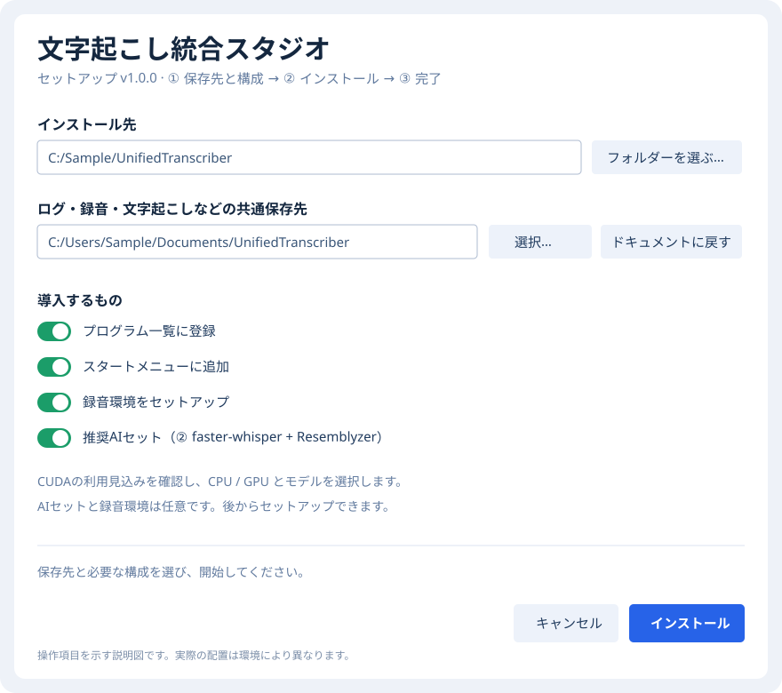

上の説明図はAIセットをONにしていますが、導入は任意です。

追加方式の導入は **設定・診断 → 環境の準備・確認 → 一括セットアップ…** から行います。

旧版から方式②を使っている場合は、アプリ本体の更新後に、一括セットアップで **方式②を再実行して認識環境も更新** してください。他の従来方式にはモデルの読み込みに関する確認事項が残ります。信頼できる配布元のモデルを使い、外部から受け取った `.pt`／`.pth`／`.ckpt` を持ち込まないでください。対象と制約は [点検記録](AUDIT.md#ai環境に残る確認事項) を参照してください。

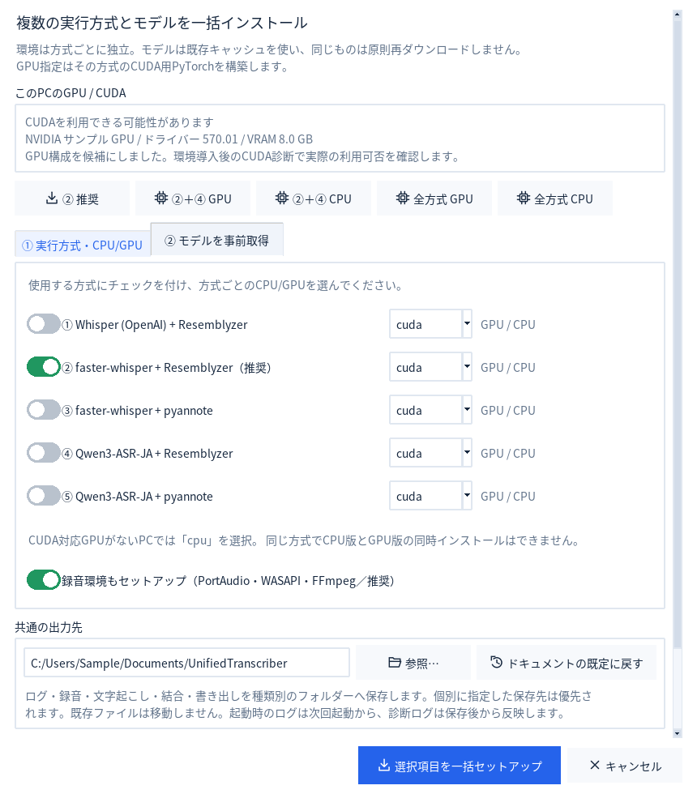

## メイン画面の見方

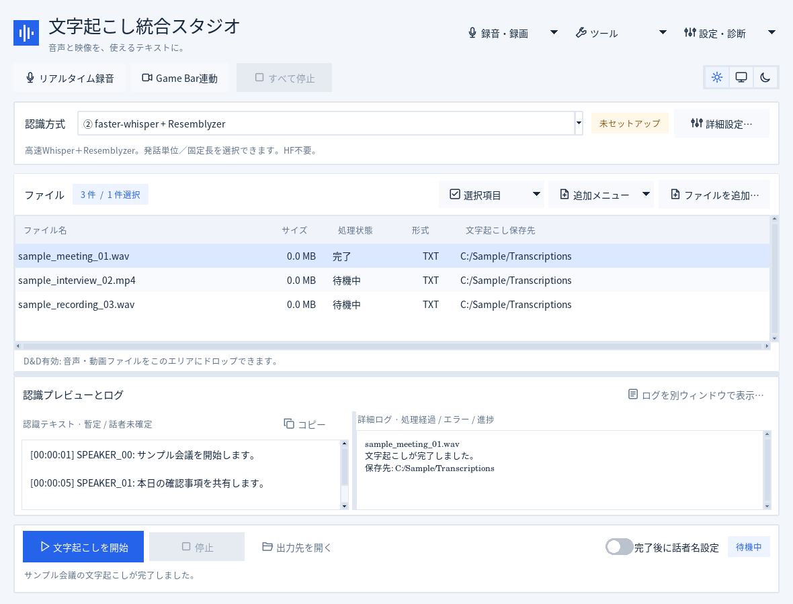

| 画面の場所 | 使い方 |
| --- | --- |
| TOPのリアルタイム録音／Game Bar | 前回設定で開始。Shift＋クリックで設定を開きます。初回は必ず設定画面を開きます。 |
| 認識方式と「詳細設定…」 | 方式、モデル、CPU／GPU、話者分離、保存先・出力形式を確認します。 |
| 「単語辞書…」 | 固有名詞を認識時のヒントとして登録・選択します。 |
| ファイル一覧（キュー） | 追加したファイルを順次処理します。完了した行のダブルクリックで結果を開きます。 |
| 左の認識プレビュー | 認識文を表示します。「コピー」はスクロールで隠れた部分も含めた全文をコピーします。 |
| 右の詳細ログ | 進捗・処理経過・エラーの理由を確認します。別ウィンドウでも開けます。 |
| 下部の開始・停止 | ファイルの認識を開始します。すべて中断したいときは、TOPの「すべて停止」を使います。 |

上部のメニューは、クリックすると下へ展開します。中カテゴリを開き、操作を選びます。縦に長い設定画面はスクロールして下の項目を確認してください。

## ファイルを文字起こしする

1. **「ファイルを追加…」** またはドラッグ＆ドロップで音声・動画をキューへ追加します。フォルダー追加・監視は「追加メニュー」から利用できます。
2. 認識方式とモデルを選び、**「詳細設定…」** で保存先と出力形式を確認します。認識方式の既定は②（推奨）です。TXT／CSV／両方から選べます。
3. **「文字起こしを開始」** を押します。認識文は左のプレビューへ、進捗や詳細は右のログへ表示します。
4. 完了した行をダブルクリックして結果画面を開き、**「結果の保存先を開く」「元ファイルの場所を開く」「この結果の話者名を設定」** を選びます。保存先の列をダブルクリックすると、そのフォルダーを直接開きます。

入力形式はMP4／MOV／MKV／AVI／MP3／WAV／M4A／FLAC／AAC／WMAです。複数ファイルをまとめて追加できます。

ファイルごとの保存先・形式・既存出力の扱いは、一覧から選んで「選択項目」から変更します。上書き・スキップ・別名保存を指定できます。キューの項目をDeleteで外しても、元ファイルは削除しません。

通常のプレビューは次のファイルの認識開始時に切り替わります。ライブ中は結果を続けて追記し、停止後の全文再解析が始まるときは一度クリアして録音の先頭から表示します。

## 認識用の単語辞書

メイン画面の **「単語辞書…」** または **設定・診断 → 操作・設定 → 認識用の単語辞書…** を開きます。

1. **「単語辞書を使用する」** をオンにします。初期状態はオフです。
2. 「共通」に、どの用途でも使いたい単語を追加します。「表記」に、たとえば `青空株式会社` のように入力し、「単語を追加」を押します。「読み」は辞書を管理するときのメモであり、認識エンジンには送られません。
3. 必要に応じて用途別のグループを作り、単語を追加して使用するグループを選びます。共通グループは辞書がオンのとき常に使われます。
4. **「辞書を保存」** を押してから、ファイルの文字起こしやライブ録音を開始します。

登録語は認識時のヒントです。**認識後の文章を自動で置換することはありません。** 正しい認識は保証されません。辞書は最大1,000語、グループは最大50個、単語と読み方はそれぞれ120文字までです。認識時に渡せる量には上限があるため、一部の単語が使われないことがあります。「、」は区切り文字のため、単語には使用できません。

辞書画面の「辞書を書き出す…」「辞書を読み込む…」で辞書だけを別のPCへ移せます。設定全体の書き出し・読み込みにも辞書が含まれます。辞書はローカルに保存されます。読み込みは編集中の辞書を置き換え、「辞書を保存」を押すと反映されます。

## 録音・ライブ文字起こし

TOPの **「リアルタイム録音」**、または **録音・録画 → 録音・録画を開始** から開きます。

1. 動作モードと音声入力元（マイク／PC再生音／両方）を選びます。
2. 「デバイス更新」で機器を選び、「入力テスト」で音が入ることを確認します。
3. 保存形式・チャンネル・録音先、ライブ認識の区間、停止後の認識を選びます。
4. 「録音を開始」を押します。終了時は「録音を終了」またはメインの「停止」を押します。

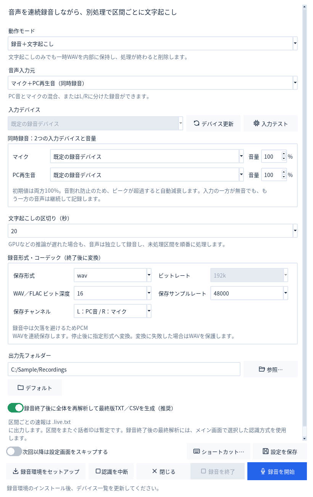

| やりたいこと | 動作モード | 停止後の文字起こし |
| --- | --- | --- |
| 録音しながら認識 | 録音＋文字起こし | 全文の最終版もほしい場合はON |
| 録音後だけ認識 | 録音のみ | ON |
| 音声だけを保存 | 録音のみ | OFF |
| 文章だけを残す | 文字起こしのみ | 一時音声は処理後に削除 |

ライブ認識は10／20／30／60秒ごとに結果を追記します。推論が遅れると未処理区間がたまるため、必要に応じて録音のみ＋停止後の認識へ変更します。ライブの話者番号は区間ごとの暫定値です。全文の最終解析では録音全体で話者分離をやり直します。

音を分けて編集したい場合は、音声入力元を両方、保存チャンネルを **「L：PC音 / R：マイク」** にします。PC音をモノラルで左、マイクを右に保存します。録音はまずWAVを連続保存し、停止後に設定した形式へ変換します。変換に失敗した場合は元WAVを保持します。

## Game Barで画面も録る

TOPの **「Game Bar連動」**、または **録音・録画 → 録音・録画を開始** から開きます。

1. Windows側のGame Barが有効で、対象アプリを録画できることを確認します。
2. 「画面を選ぶ…」から、一覧のプレビューを見て対象ウィンドウを選びます。
3. 録画開始／停止キーをWindows側とそろえ、音声入力元と保存先を選びます。
4. 録画中の文字表示が必要なら **「録画中にライブ文字起こし」** をONにします。停止後の全文認識、別録音音声を同期したMP4の作成は個別に選べます。
5. 「録画を開始」し、終了時に「録画を停止」を押します。録画・音声・文字起こしの保存結果を確認します。

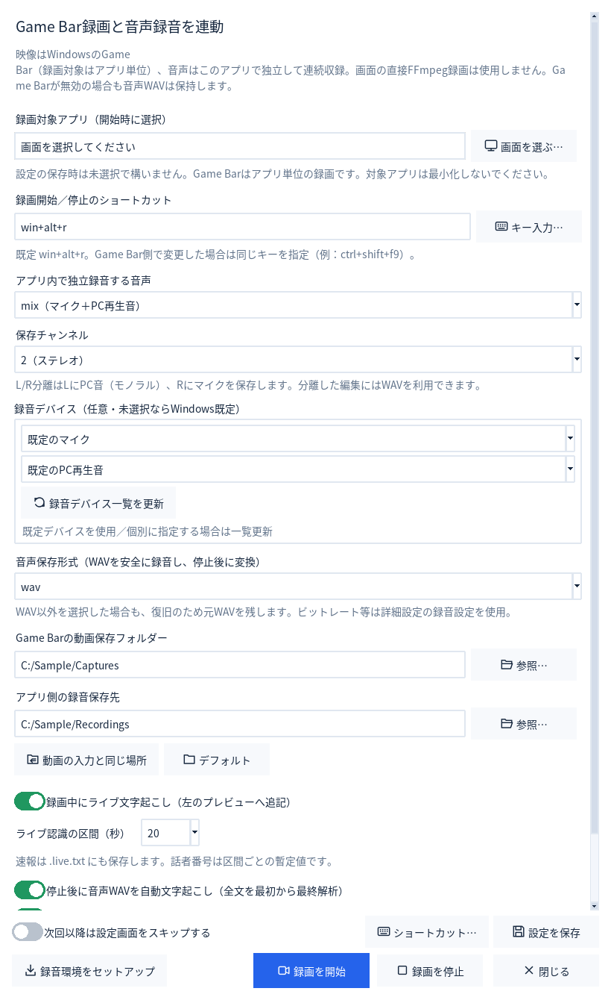

初回は必ず設定画面を開きます。「次回以降は設定画面をスキップする」をONにして保存すると、TOPからは前回の収録設定を使用します。**Shift＋クリック** またはメニューから開くと、毎回設定できます。スキップ中も録画対象だけは毎回選びます。対象ウィンドウは設定として保存しません。

Game Barはデスクトップや一部のアプリを録画できません。同期は開始時刻を基準にした概算です。Game BarのMP4が見つからない場合も、本アプリで独立録音した音声を保持します。

収録済みのMP4は **録音・録画 → 取り込み・環境 → 標準録画を取り込み・文字起こし…** から読み込めます。別音声のミックス／置き換えと開始位置の補正もできます。

## 話者名を整える

完了したキューをダブルクリックして「この結果の話者名を設定」を選ぶか、**ツール → 変換・話者名 → 話者名を設定…** から開きます。

1. 話者付きTXT／CSVを読み込み、「解析」を押します。
2. 「発話を表示」または「すべて開く」で発言を確認し、割当名を入力します。
3. 別名保存の場所を確認し、**「話者名を置換して保存」** を押します。

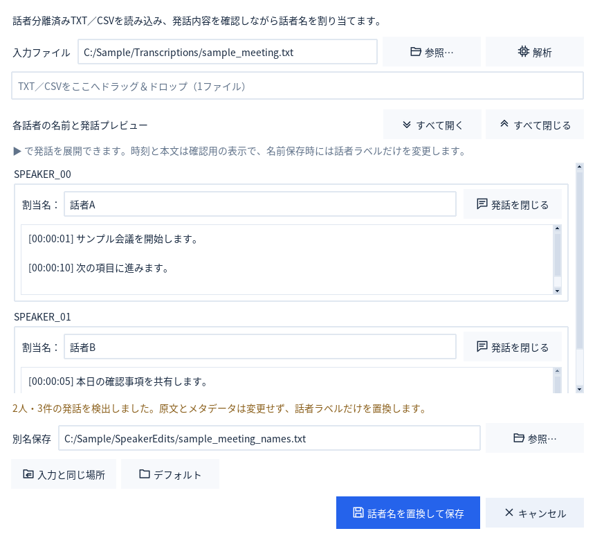

名前は自動特定しません。同じSPEAKER_00でも、異なる録音では別人の可能性があります。保存時に変更するのは話者ラベルだけで、発言本文やメタデータ中の同じ文字は変更しません。元ファイルは上書きせず、別名で保存します。

メインの **「完了後に話者名設定」** をONにすると、文字起こし完了後に結果を順番に開きます。

## 結合・変換

**ツール → 結合・音声の抽出** からTXT／CSV／音声の結合を開きます。

1. ファイルを追加し、結合順を確認します。「↑ 上へ」「↓ 下へ」で並べ替えます。手動の順番を保つときは「手動順・追加順」を選びます。
2. 保存場所・ファイル名を確認します。音声結合では形式、ビットレート、チャンネルなども選べます。
3. 必要に応じて元ファイルの退避をONにし、「結合を開始」を押します。

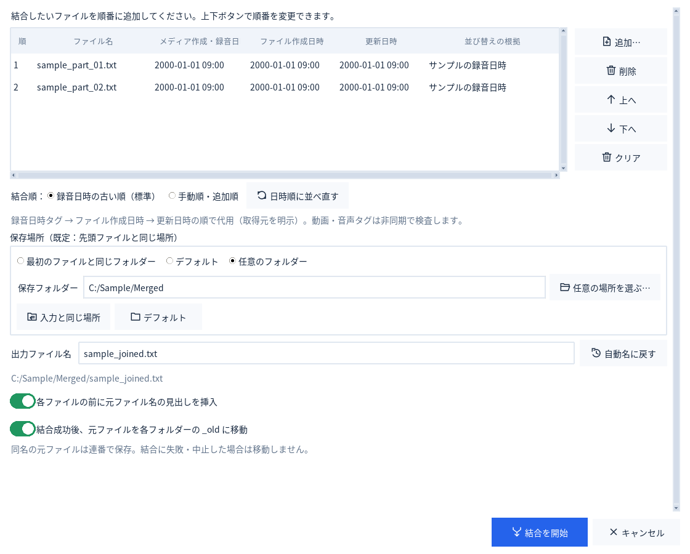

**「結合成功後、元ファイルを各フォルダーの _old に移動」** は初期OFFです。ONの場合、結果を保存できた後に元ファイルを移動します。失敗・保存前の中止では移動せず、同名の退避ファイルは連番で保護します。元ファイルを別のソフトから参照している場合は、移動で参照先も変わります。

音声結合は動画からの音声取り出しと、結合後の自動文字起こしにも対応します。認識設定はメイン画面の選択を使い、結合音声は認識が失敗しても保持します。

TXT ⇔ CSV変換は **ツール → 変換・話者名** から開きます。情報保持CSVは見出し・空行・元の行順を補助列へ保存します。主に時刻・話者・本文を編集し、TXTへ戻す予定なら補助列を保持してください。情報を黙って捨てることがないよう、表せない独自列などがある場合は変換を中断します。

**外部由来のCSVをExcelで開く場合：** ダブルクリックせず、「データ → テキストまたはCSVから」で読み込み、本文・話者・ファイル名の列を文字列として指定します。文章の先頭が `=` などの場合、Excelが数式と解釈することがあります。外部リンクや実行を促す警告は承認しないでください。

## 保存先・表示・ショートカット

保存先は **「入力と同じ場所」「デフォルト」「任意」** から選びます。「デフォルト」は共通保存先の用途別フォルダーです。共通保存先の既定は **ドキュメント内の `UnifiedTranscriber`** で、OneDrive・別ドライブなどへ移動済みのドキュメントにも対応します。

| 保存するもの | 共通保存先内のフォルダー |
| --- | --- |
| 文字起こし・TXT／CSV変換 | `Transcriptions` |
| 録音・同期後の動画 | `Recordings` |
| 結合結果 | `Merged` |
| 話者名編集結果 | `SpeakerEdits` |
| 起動・処理・追加セットアップのログ | `Logs` |
| 設定JSON・診断ZIPの書き出し | `Exports` |

共通保存先は、**本体のセットアップ、一括セットアップ、方式別セットアップ、詳細設定の保存先設定**から変更できます。変更後のログは新しい場所へ記録します。起動時から開いている `gui_startup.log` は、次回起動から新しい場所になります。

個別に設定した保存先と「入力と同じ場所」は共通保存先より優先されます。既存ファイルは自動移動しません。旧版のログや、インストール先に保存した録音・結果も元の場所に残ります。結合の「入力と同じ場所」は先頭ファイルの場所を使います。Game Bar自身が作る元MP4はWindows側の指定先に保存されます。

アプリの設定はインストール先の `Data/settings.json` に、Python・追加環境・モデルキャッシュもインストール先に置きます。

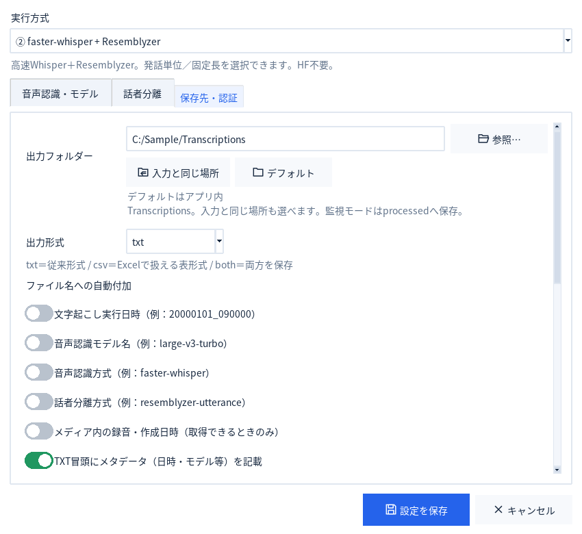

TOP右上の3アイコンは、左から **太陽＝ライト／モニター＝デバイスに合わせる／月＝ダーク** です。選択欄・数値欄は、一度クリックしてフォーカスした後だけホイールで変更できます。

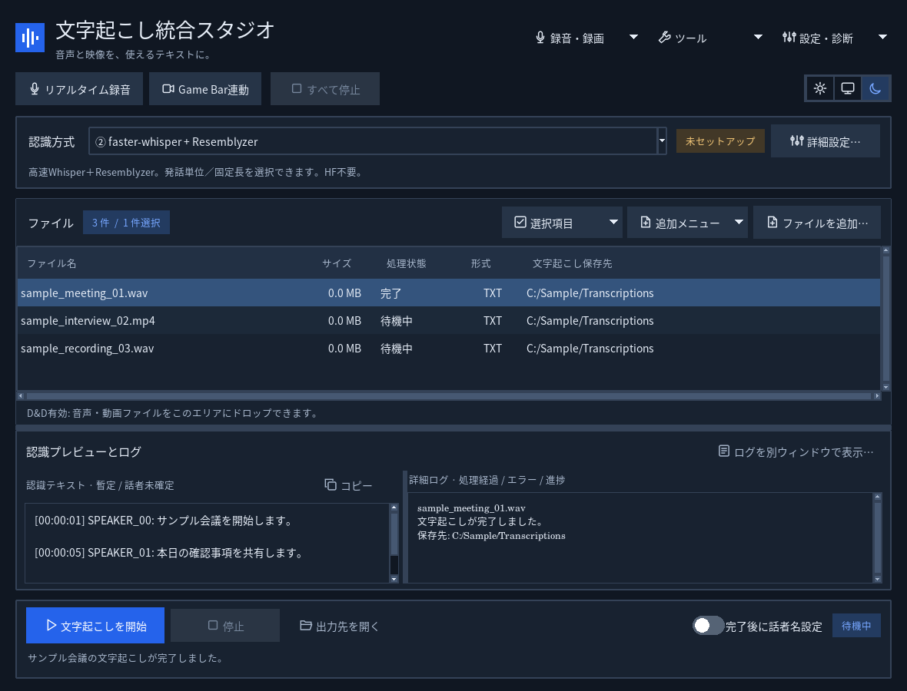

ショートカットは **設定・診断 → 操作・設定 → 録音・録画のショートカット…** の「キー入力」から、実際の組み合わせを押して登録します。

**設定・診断 → 操作・設定 → 自動起動・常駐の設定…** では、Windowsサインイン時に通知領域で待機するか、最小化や閉じる操作で通知領域に格納するかを個別に選べます。いずれも初期状態ではオフです。通知領域のアイコンをクリックすると画面へ戻り、右クリックのメニューから録音・停止・完全終了ができます。アイコンが見当たらないときは、Windowsの通知領域にある隠れたアイコンを確認してください。録音キーが未設定、または他のアプリと重複している場合は登録し直します。Game Barは毎回対象ウィンドウを選びます。

| キー | 操作 |
| --- | --- |
| Ctrl＋O | ファイルを追加 |
| Ctrl＋Enter | 文字起こしを開始 |
| 一覧内のCtrl＋A | 全選択 |
| 一覧内のDelete | 一覧から外す。元ファイルは保持 |
| F1 | 使い方を開く |

## 設定を別のPCへ移す

**設定・診断 → 操作・設定 → 設定を書き出す…** でJSONへ保存します。移行先で **「設定を読み込む…」** を選びます。アプリ内・ユーザーフォルダー内の保存先は移行先に合わせて反映します。

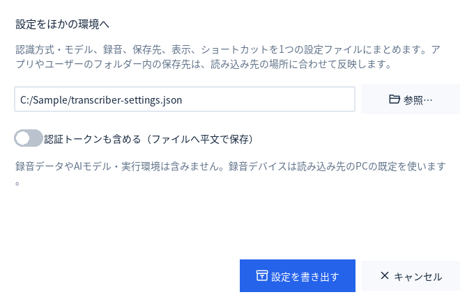

モデル・実行環境・録音はJSONへ含まれません。移行先で必要な環境を導入し、録音デバイスも選び直してください。「認証トークンも含める」をONにしたJSONにはトークンを平文で含みます。このファイルを共有・コミットしないでください。

## 停止の使い分け

- **「停止」「録音を終了」「録画を停止」：** 録音・録画を保存し、設定された終了後の文字起こしを続けます。
- **TOPの「すべて停止」：** 待機中の認識、全文解析、結合、変換、監視、セットアップなども中断します。終了処理が完了してから、次の操作を始めます。

## 更新・修復・アンインストール

**設定・診断 → サポート → アプリの更新・確認間隔…** を開きます。更新チェックの間隔は **「起動するたび」「指定した日数ごと」「確認しない」** から選びます。「今すぐ確認」で手動確認もできます。新しい版が見つかると確認画面を開き、**「ダウンロードして更新」** を選ぶと取得・検証後に更新へ進みます。録音や認識を終えてから更新してください。取得・検証に失敗した更新は実行せず、現在のアプリを使い続けられます。

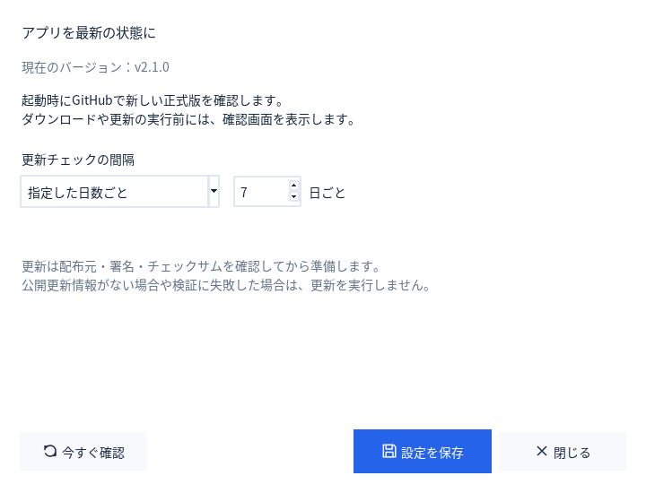

セットアップexe、またはインストール先の **`UnifiedTranscriberSetup.exe`** を開くと、既存の版を確認します。

| インストール済みの版 | 選べる操作 |
| --- | --- |
| セットアップexeより古い | 設定・モデル・出力を引き継いで更新 |
| 同じ版 | 修復／アンインストール／キャンセル |
| より新しい版 | 新しい版の保守プログラムによる修復／アンインストール／キャンセル。古い版への上書きは不可 |

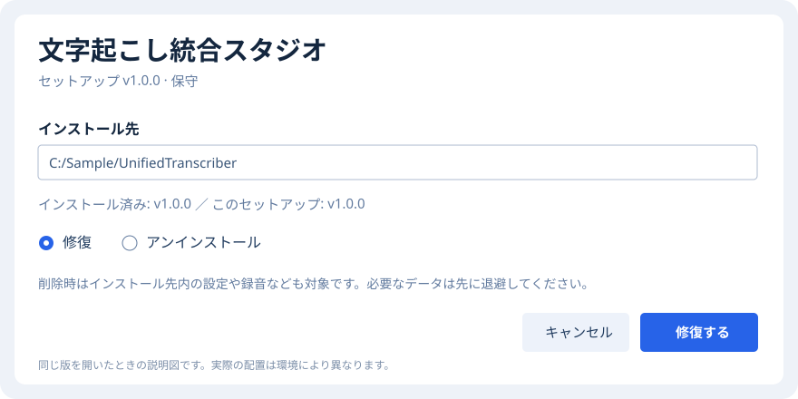

削除する場合は、保守画面の **「アンインストール」** から進めます。インストール先内の設定・実行環境・モデル・録音・結果も対象になるため、必要なものは先に退避してください。

アプリの実体はインストール先にまとまっていますが、フォルダーを手動削除するとプログラム一覧やショートカットが残ることがあります。保守画面を使うと、その登録も片付けます。ドキュメント内など、インストール先の外に保存した出力は残ります。旧版の外部設定、既存のWindowsユーザー環境変数 `HF_TOKEN`、共有の外部モデルキャッシュも削除しません。

手動で更新・修復・アンインストールする場合は、先に通知領域アイコンを右クリックし「アプリを終了」で完全に終了してください。保守画面からのアンインストールでは、このインストール先の自動起動登録も解除します。

更新確認はGitHubの公開リリースを想定しています。非公開リポジトリのままでは取得できない場合があります。更新のための個人GitHubトークンは埋め込みません。認識文や録音を更新確認へ送信しません。

## 困ったとき

| 症状 | 確認すること |
| --- | --- |
| 未セットアップと出る | 使用する認識方式とモデルの導入を確認。録音環境と認識環境は別です。 |
| 一括セットアップで終了コード1になる | 直前の詳細ログにpipなどの子処理の出力を表示します。最初のエラーを確認し、同じ方式のセットアップを再実行します。 |
| FFmpegの導入でアクセス拒否になる | 使用中のファイルや一時的な拒否は再試行します。継続する場合は他の録音・変換を終了し、表示された保存先の書き込み権限を確認します。 |
| D&Dできない | ファイル追加ボタンで代用し、「設定・診断 → サポート → D&D 診断・修復…」を確認します。 |
| 音が入らない | デバイス更新と入力テストを実行。Windowsのマイク許可、PC音の再生先を確認します。 |
| ライブの文字が遅れる | 録音のみ＋停止後の認識、またはモデル・CPU/GPU設定を見直します。 |
| 保存先がわからない | 完了した行をダブルクリックして結果の保存先を開きます。 |
| 設定移行後に録音できない | 移行先のデバイスを選び直し、必要な環境を導入します。 |
| 更新できない | 接続・公開リリースの有無・検証エラーを確認。失敗した更新は実行されません。 |

右の詳細ログに原因が出ます。**設定・診断 → ログ** から、フォルダーを開く／別ウィンドウで見る／ZIPに保存する操作を選べます。ログにはファイルパス・デバイス名・認識結果が含まれることがあるため、共有前に内容を確認してください。

本体のセットアップ中に行う追加環境の導入は、共通保存先の `Logs/setup_*.log` に詳細を記録します。アプリ内の一括セットアップは、画面の詳細ログと `Logs/session_*.log` でpipなどの出力を確認できます。失敗した場合も、本体と取得済みのモデルは保持します。

### Python・依存ライブラリの対応範囲

配布exeには、GUI・従来方式用のPython 3.11.18と、方式②・録音用のPython 3.14.10（`MLRuntime`）を同梱します。グローバルなPythonや依存ライブラリを利用者が先に導入する必要はありません。方式②・録音は対応するWindows wheelの構成に更新しています。Python 3.15は必要なwheelがそろっていないため、現時点では対応対象外です。①・③・④・⑤は従来の互換構成を維持します。

画面のファイル名・本文・日時・名前はすべて架空のサンプルです。Windows実機の録音・Game Bar・GPUで確認した範囲は [VALIDATION.md](VALIDATION.md)、点検結果は [AUDIT.md](AUDIT.md) を参照してください。
